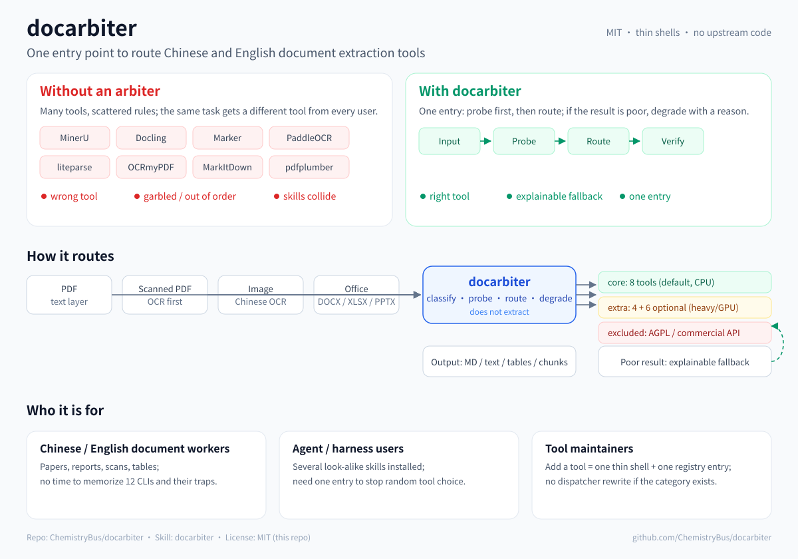

# docarbiter

> A **Chinese- and English-first document extraction arbiter** plus a curated tool collection: it tells you what to install, when to switch, and where each tool breaks.

[中文](README.md) | **English**

**Repo:** `ChemistryBus/docarbiter` (first public release `v0.1.0`)
**Skill:** `docarbiter`
**Status:** v0.1.0 — first public preview (core is runnable). The arbiter, 12 thin shells, wrappers, an executable `route.py` with self-test, `bench.py` / `bench_abstract.py` / `bench_policy.py`, 11 synthetic bilingual fixtures, 4 real CC BY-SA fixtures, CID/traditional/interleaved/true-vertical edge fixtures, a qualitative real two-column check plus BERT abstract CER, table cell accuracy with default/text strategy comparison, five real high-frequency tables (WS/T 578.1 / GB 28050 / DRIs 2023 / GB 2760 / China Food Composition Tables) with tool routing, the core 8 tools, an OCR-path comparison, a clean-venv install/reliability pass, a read-only survey of 8,444 real workspace PDFs plus a 4-file smoke, a P0 policy benchmark, and Claude Code / DSH P4 trigger tests (old `doc-extract` backed up and disabled) are in place; the extra layer is not installed (option A).



## Validation status (summary)

| Area | Status | Details |
|---|---|---|
| Core text layer / scans / CID / two-column | tested | [docs/benchmarks.md](docs/benchmarks.md) |
| Real high-frequency tables (WS/T, GB 28050, DRIs, GB 2760, food composition) | structure + spot checks | [docs/policy.md](docs/policy.md) P2 |
| P0 routing policy (22 documents with answer keys) | tested | [docs/policy.md](docs/policy.md) |
| Claude Code / DSH trigger | tested | [docs/p4-claude-code.md](docs/p4-claude-code.md) / [docs/p4-other-harnesses.md](docs/p4-other-harnesses.md) |
| ZCode / Codex / MiniMax trigger | not complete | configure after release via [docs/harness-integration.md](docs/harness-integration.md) |
| Linux / Windows | Linux CI pending; Windows unverified | stated in release notes |

Full tables, failure pages, and worst cases live in `docs/`; the README keeps only a summary so install instructions and test evidence do not get mixed together.

---

## What problem it solves

There are many high-star PDF and image extraction tools on GitHub. On real Chinese and English documents, three things go wrong:

1. **Wrong tool.** Users pick by star count or the first search result. They do not know the boundaries between MinerU, Docling, Marker, PaddleOCR, liteparse, and MarkItDown.
2. **One language is not the other.** Chinese PDFs fail differently: CID subset fonts without ToUnicode, scans that need a Chinese OCR model, two-column/vertical text, full-width punctuation, and merged table cells. High English scores do not imply usable Chinese output.
3. **Look-alike skills collide.** A harness with three or four "PDF extraction" skills matches all of their descriptions, picks one at random, and the result is not reproducible.

The answer here is not another extractor. It is three things:

- a **tool list tested on Chinese and English corpora** (what to install, what not to, and why);
- **one routing decision table** (input, language, goal, tool);
- **thin-shell skills**: positioning, install, commands, measured traps, upstream link — no upstream code copied.

## Who it is for

| Audience | Why they need it |
|---|---|
| **Chinese/English document workers** | Papers, reports, scans, and tables; they do not want to memorize a dozen CLIs and their traps. |
| **Agent / harness users** | Several look-alike skills are installed; they need one entry point to stop random tool choice. |
| **Tool maintainers** | Adding a tool = one thin shell + one registry entry; the dispatcher does not need a rewrite if the category already exists. |

**Not for:** people who want a new PDF parser, a vendor onboarding pack, or a cloud OCR API that uploads their files by default.

## What it is / is not

**Is:**

- a selection guide + routing skill + reproducible bilingual benchmark
- vendor-neutral: it routes among competing open-source tools
- thin-shell distribution: `scripts/install.sh` calls upstream package managers; this repo contains no upstream code
- one default skill (`docarbiter`); `--profile full` optionally registers the individual tool skills

**Is not:**

- a new PDF parsing library
- a vendor onboarding pack
- a home for Anthropic's `pdf` skill (Proprietary; link only)
- a home for PyMuPDF or PDF-Extract-Kit (AGPL-3.0; link only, with reasons)

## Tool map

### Core layer (default install, CPU-friendly, permissive licenses)

| Tool | ★ | License | Role | Chinese/English status |
|---|---:|---|---|---|
| **MinerU** | 83k | Apache-2.0 + additional terms | PDF → structured Markdown, headings, page anchors | Demo 0.0046 / 0.0013; scans 1.59% / 0.20% |
| **Docling** | 70k | MIT | Office / HTML / EPUB / audio / video / RAG chunks / LaTeX / complex merged tables | Demo 0.0061 / 0.0093; scans 1.01% / 7.12%; best structure/reading order on real merged tables |
| **liteparse** | 13k | Apache-2.0 | Fastest text-layer PDF; word coordinates and fonts | Demo 0.13–0.42 s / 0.0061; 0.14 s / 0.0079 |
| **MarkItDown** | 195k | MIT | Simple single-column PDF / Office | Demo 0.0061 / 0.0185; clean synthetic columns pass; real papers with figures interleave; scans not supported |
| **RapidOCR** | 8.5k | Apache-2.0 | Image / screenshot OCR | Chinese scan 1.16%; English scan 0.10% |
| **OCRmyPDF** | 35k | MPL-2.0 | Add a text layer to scanned PDFs | Chinese scan 10.1%; English scan 0.20% |
| **pdfplumber** | 11k | MIT | Simple bordered tables / character coordinates | Synthetic grid/merged 1.000; real multi-line cells scramble; borderless 0 tables (text strategy 1.000/0.917 but hurts merged); interleaved two-column 60–68% |
| **pdftotext** (Poppler) | — | GPL-2.0/3.0 | Plain-text baseline, text-layer probe | Text layer only; CID/no-ToUnicode produces garbage |

### Extra layer (install on demand; heavy, GPU, or special)

| Tool | ★ | License | Role | Notes |
|---|---:|---|---|---|
| **PaddleOCR** | 92k | Apache-2.0 | Chinese OCR / PP-Structure layout and tables | Chinese-native; heavy paddlepaddle dependency |
| **Marker** | 41k | Apache-2.0 | PDF → Markdown | Multilingual; GPU recommended; Chinese CER pending |
| **Unstructured** | 16k | Apache-2.0 | Enterprise multi-format ingestion | Heavy; Chinese depends on the OCR backend |
| **olmOCR** | 20k | Apache-2.0 | VLM OCR for scans | GPU required; Chinese CER pending |
| **Surya** | 22k | Apache-2.0 | OCR / layout / reading order | Marker's underlying models; GPU recommended |
| **Camelot** | 3.8k | MIT | Table extraction | Text-layer tables; complements pdfplumber |
| **Tesseract** | 77k | Apache-2.0 | OCR fallback | `chi_sim` is weaker than PaddleOCR |
| **qpdf / pypdf / pdfminer.six** | 5.6k / 10k / 7k | Apache-2.0 / BSD-3 / MIT | Split, merge, decrypt, low-level text | PDF operations and fallback, not layout |

### Considered but not on the default path

| Tool | License | Why not |
|---|---|---|
| **PDF-Extract-Kit** | AGPL-3.0 | Copyleft; link only |
| **PyMuPDF** | AGPL-3.0 | Copyleft; not installed or recommended |
| **Anthropic `pdf` skill** | Proprietary | Cannot be redistributed; handles merge/split/forms, not structured extraction |
| **LlamaParse / Azure Document Intelligence / Google Document AI / Adobe PDF Extract / Mathpix** | Commercial API | Data leaves the machine, per-page cost; not a local default |

> Scan routing: Chinese → **RapidOCR / MinerU / Docling** (1%–1.6%), do not default to Tesseract `chi_sim` (~10%); English → RapidOCR / MinerU / OCRmyPDF (0.1%–0.2%), check Docling on English scans (7.1% this run).
> Full registry (stars, licenses, install commands, bilingual status, exclusion reasons): [`docs/tool-registry.md`](docs/tool-registry.md) and [`registry.json`](registry.json).
> `Surya` / `Camelot` / `Tesseract` / `qpdf` / `pypdf` / `pdfminer.six` are optional supplements without a separate thin shell.

## One entry point

The default install registers **one** skill: `docarbiter`. It does **not** extract documents itself. It:

1. classifies the input (PDF / Office / image / audio-video);
2. probes whether a PDF has a **usable** text layer (not just a character count);
3. routes by goal (speed / manuscript / tables — simple grids or complex merged tables / RAG / OCR);
4. degrades with an explanation when the result is poor.

The 12 tool shells live in `skills/_tools/` and are read on demand; they are **not discovered as separate skills** by default. Users who want `/mineru` or `/liteparse` directly can install `--profile full`.

The collection can grow: the routing rules live in the dispatcher, the tool facts live in `registry.json`, and each tool's details live in one thin shell. Adding a tool in an existing category does not require rewriting the dispatcher. See [`docs/architecture.md`](docs/architecture.md).

## Executable router (optional)

For scripts and non-agent users, the same decision table is available as a CLI:

```bash
python3 -I scripts/route.py file.pdf --goal manuscript
python3 -I scripts/route.py file.pdf --goal table --json            # simple grid -> pdfplumber
python3 -I scripts/route.py file.pdf --goal table-structure --json  # merged/multi-line -> Docling
python3 -I scripts/route.py --selftest
```

It prints `probe` (chars / CJK / control chars / bad ratio), `intended` / `selected`, `reason`, `command`, and `fallback`. `--selftest` verifies routing on the repository fixtures (text layer / scan / CID / traditional / interleaved / real CC BY / tables / complex tables).

## Bilingual evaluation

This is the line between this project and a plain tool directory.

### Where the answer key comes from

Tools can extract, but they cannot be the answer. Using tool A's output as the answer key only measures "how much B looks like A." Answer sources:

1. **Synthetic PDFs**: we write the text and render it with a CJK/Latin font; the source text is the exact answer. Covers normal text layers, CID/no-ToUnicode, two columns, tables, and mixed scripts.
2. **CC BY-SA Chinese Wikipedia / CC BY-SA English Wikipedia**: the article source text is the answer; render it to PDF. Real content, reproducible, redistributable.
3. **Public-domain Chinese classics (Wikisource)**: source text as the answer; tests traditional characters and vertical text.
4. **Your own PDFs**: put them in `benchmarks/private/` (gitignored); run locally, do not publish the scores.

### Metrics

- **CER (character error rate)**, not English word-level similarity. Chinese has no spaces; word-level metrics mislead.
- Itemized: Han characters / punctuation / digits / Latin / reading order / table cells.
- Per-page CER + per-document CER; report median, IQR, and the **worst page**. Never hide a catastrophic page behind one average.
- Normalization is fixed in `bench.py`: NFC, remove whitespace, keep full-width punctuation; also report raw CER.
- Environment: macOS / M2 Pro is the measured environment; Linux / Windows are marked "unverified".
- Reproduce: `python3 -I scripts/bench.py your.pdf`.

First **bilingual demo** (one synthetic page per language, source text as the answer, 2026-11-09):

| Tool | Version | ZH time (3-run range) | ZH CER | EN time (3-run range) | EN CER | Note |
|---|---|---:|---:|---:|---:|---|
| pdftotext | Poppler 26.08.0 | 0.03 s | 0.0000 | 0.04 s | 0.0000 | Baseline; matches source text |
| liteparse | 2.18.0 | 0.13–0.42 s | 0.0061 | 0.14 s | 0.0079 | Fastest; quotes/dashes normalized to ASCII |
| markitdown | 0.1.9 | 0.98–1.19 s | 0.0061 | 0.90–0.98 s | 0.0185 | Single-column; English punctuation normalization is most visible |
| mineru | 4.1.7 | 1.0–9.6 s | **0.0046** | 1.0–3.9 s | **0.0013** | Lowest CER in both; time range is cold/warm service and models |
| docling | 2.149.0 | 9.5–19.3 s | 0.0061 | 9.5–12.2 s | 0.0093 | Slowest; usable in both languages |

Caveats:

- This is **two synthetic pages**, not a full bilingual benchmark. Do not rank tools from it.
- The 0.6%–1.9% gap is mostly punctuation normalization (`“”` → `""`, `——` → `--`), not typos. See `docs/gotchas.md` item 8.
- MinerU's `raw CER` is higher because Markdown markers (`#`, `|`, table separator rows) are counted; `cer_text` strips them. **Raw CER across different output formats is not comparable.**
- Timings are sensitive to cold/warm start: MinerU ranged 1.0–9.6 s across three runs, Docling 9.5–19.3 s. Report cold and warm separately before release; do not use one number for everything.
- Next: real CC BY-SA articles, CID/no-ToUnicode, traditional/simplified, vertical text, and separate cold/warm runs.

**11-fixture bilingual smoke corpus (5 tools, synthetic):** MinerU median CER 0.0030; pdftotext / markitdown 0.0000; liteparse / Docling 0.0130. Only MinerU / Docling produced content for the two scans; **no-punct CER is 0.0000 for every tool**, so the residual is punctuation normalization, not typos.

**4 real CC BY-SA Wikipedia articles (1–2 pages):** no-punct CER is 0.0000 for every tool; text CER 0.02%–2.5%, again punctuation-driven; MinerU is worst at 2.51% (zh-ocr) but no-punct 0. Sources, modifications, and CC BY-SA attribution: [`benchmarks/fixtures/real/SOURCES.md`](benchmarks/fixtures/real/SOURCES.md). Full table and reproduction: [`docs/benchmarks.md`](docs/benchmarks.md).

**Edge fixtures (CID / traditional / interleaved two-column / true vertical):** on CID/no-ToUnicode, every text-layer tool is garbled while **MinerU scores 4.95%**; on clean synthetic interleaved columns, **pdfplumber is 60%–68%** while pdftotext / liteparse / markitdown / MinerU are 0; traditional is essentially correct; true vertical (Chrome `vertical-rl`) is bad for every tool: Docling 26.7%, MinerU 29.5%, markitdown 41.9%, pdftotext 78.1%, liteparse 90.5%, pdfplumber 97.1%.

**Real two-column paper (ResNet arXiv:1512.03385, 3 pages, local private):** MinerU / Docling / liteparse produce a readable abstract; markitdown is broken by figures/axis labels; pdfplumber loses spaces between words. No answer key, so this is qualitative, not CER.

**Real CC BY two-column abstract CER (BERT, ACL Anthology N19-1423):** MinerU **0.44%**; pdftotext / liteparse / Docling **0.65%**; markitdown / pdfplumber **73%**, and no-punct is still 73% — reading order/interleaving, not punctuation. Abstract only; body, figures, tables, and references are not scored.

**Table cell accuracy (pdfplumber, 6 fixtures):** grid / merged **1.000** by default; borderless **0 tables / 0.000**, while the text strategy recovers **1.000/0.917** but drops merged cells to **0.667/0.583** and clips English. No single setting wins; the merged-cell 1.000 proves row/column alignment, not merge semantics. See [`docs/benchmarks.md`](docs/benchmarks.md).

**Real high-frequency tables (2026-11-10, five local files, read-only, never uploaded):**

| Document (page) | Result |
|---|---|
| WS/T 578.1—2017 p8 (21×13, three-level header) | **Docling** expands headers to "male PAL - light(I) - MJ/d"; pdfplumber flattens them; MinerU keeps rowspan/colspan |
| GB 28050—2025 p6 (28×4, multi-line cells) | **Docling** spot-checked correct; pdfplumber cell order scrambles; MinerU interleaves text in 7 cells |
| DRIs 2023 p65 (two symbol tables) | **MinerU** recovers Chinese names and maps ●/○ to blank/O; Docling needs OCR and still loses the glyphs |
| GB 2760—2024 p13 (26×4) | **Docling** spot-checked correct; pdfplumber gets the row count; MinerU interleaves 4 cells |
| China Food Composition Tables, 6th ed. vol. 1, p246 (65 entries, two panels) | **Docling OCR** aligns most rows; page-top/bottom rows still shift; MinerU also shifts; manual spot-check required |

Routing: simple bordered grids/coordinates → `--goal table` (pdfplumber, <0.5 s/page); merged headers/multi-line cells/book tables → `--goal table-structure` (Docling, 3–5 s/page; 10–12 s/page with OCR); scans/bad text layers → MinerU (~2.5 s/page). **The router probes only the first 3 pages; for books/standards, locate the target page and probe that page. No tool is accurate on every table; detecting a table is not the same as extracting its cells correctly.** Details: [`docs/policy.md`](docs/policy.md) P2 and [`docs/benchmarks.md`](docs/benchmarks.md) section 5.8.

**P0 policy comparison (22 documents with answer keys):**

| Policy | Success | Median CER | Worst CER | Total time |
|---|---:|---:|---:|---:|
| Fixed MinerU | 100% | 0.0115 | 0.2952 | 61.98 s |
| `router:text` | **100%** | **0.0000** | 0.7810 | **4.73 s** |
| `router:speed` | **100%** | 0.0063 | 0.9048 | **7.06 s** |
| `router:quality` | **100%** | 0.0079 | **0.2952** | 60.04 s |
| oracle (upper bound) | 100% | 0.0000 | 0.2667 | 47.17 s |

Full table, negative P1 verify result, P2 real-table work, and P3 decisions: [`docs/policy.md`](docs/policy.md). **This does not mean "more accurate than the best tool on every document"; it means better success/speed/median CER on a mixed corpus.**

Reproduce:

```bash
python3 -I benchmarks/fixtures/make_demo.py
python3 -I scripts/bench.py \
  benchmarks/fixtures/demo-zh.pdf benchmarks/fixtures/demo-en.pdf \
  --tools pdftotext,liteparse,markitdown,mineru,docling \
  --out /tmp/docarbiter-demo --keep-raw
```

## Repository layout

```
docarbiter/
├── README.md                        # Chinese
├── README.en.md                     # English
├── LICENSE                          # MIT
├── THIRD_PARTY_NOTICES.md           # per-tool licenses and copyright
├── registry.json                    # machine-readable tool registry
├── requirements-core.lock           # pinned core versions
├── requirements-extra.lock          # extra versions (not all benchmarked yet)
├── requirements-dev.lock            # benchmark/fixture generation only
├── skills/
│   ├── docarbiter/SKILL.md          # the only default entry point
│   └── _tools/                      # 12 thin shells (not registered by default)
├── scripts/
│   ├── install.sh                   # core / extra / full / --skills-only
│   ├── doctor.sh                    # versions, commands, conflicts, dual routers
│   ├── bench.py                     # bilingual CER benchmark
│   ├── bench_tables.py              # table cell accuracy (default / text)
│   ├── bench_abstract.py            # real two-column abstract CER (partial alignment)
│   ├── bench_policy.py              # fixed tools vs router vs oracle
│   ├── survey_pdfs.py               # read-only workspace PDF survey (hash + probe)
│   ├── sample_real.py               # 2-page smoke on real zh/en PDFs
│   ├── route.py                     # executable router + --selftest
│   ├── validate.py                  # frontmatter / registry / notices checks
│   └── wrappers/
│       ├── mineru-doc.sh            # fixed CWD + engine cold-start retry
│       └── liteparse-doc.sh         # OCR off by default + safe arg parsing
├── docs/
│   ├── tool-registry.md
│   ├── architecture.md
│   ├── harness-routing.md
│   ├── migration.md
│   ├── gotchas.md
│   ├── benchmarks.md
│   ├── decisions.md
│   ├── licensing-faq.md
│   ├── reliability.md
│   ├── policy.md
│   ├── p4-claude-code.md            # Claude Code real-trigger acceptance
│   ├── p4-other-harnesses.md        # Codex / ZCode / DSH / MiniMax acceptance
│   ├── harness-integration.md       # per-harness skill directory install/switch
│   ├── release-plan.md              # v0.1.0 release plan
│   ├── release-notes-v0.1.0.md      # v0.1.0 release notes draft
│   ├── release-checklist.md
│   └── assets/overview-zh.svg, overview-en.svg
├── benchmarks/fixtures/             # 11 synthetic zh/en fixtures + answers + generators
│   ├── real/                        # 4 CC BY-SA Wikipedia fixtures + SOURCES.md
│   ├── edge/                        # CID / traditional / interleaved / true vertical
│   └── tables/                      # grid / merged / borderless tables + cell truth
└── .github/workflows/validate.yml
```

## Install

```bash
git clone <repo>
cd docarbiter

# Core: 8 tools + the single docarbiter entry point (recommended)
./scripts/install.sh --profile core

# Extra: PaddleOCR / Marker / Unstructured / olmOCR / ...
./scripts/install.sh --profile extra

# Everything: core + extra + register the individual tool skills
./scripts/install.sh --profile full

# No packages: just install wrappers and register the skill (quick trial)
./scripts/install.sh --skills-only

# Health check: missing tools, versions, duplicate skills, dual routers
./scripts/doctor.sh --check-conflicts
```

For other harnesses, point `--skills-dir` at their skill directory; see [`docs/harness-integration.md`](docs/harness-integration.md) for the directory table, switching, and rollback:

```bash
./scripts/install.sh --skills-only --skills-dir ~/.dsh/skills
./scripts/install.sh --skills-only --skills-dir ~/.zcode/skills
./scripts/install.sh --skills-only --skills-dir ~/.codex/skills
./scripts/install.sh --skills-only --skills-dir ~/.minimax/skills
```

Before installing: `--profile core` only registers `docarbiter` and does not replace your existing single-tool skills. `--profile full` registers individual tool skills; if you already have same-name skills (`liteparse`, `markitdown`, `docling`), uninstall the old ones first, or run `doctor.sh --check-conflicts` after installation. **Keep exactly one document-extraction router per harness.**

## MinerU license: can we use it?

Yes.

MinerU is **Apache-2.0 plus additional terms**. The additional terms trigger only if:

1. you and your affiliates exceed **100 million MAU** or **USD 20 million monthly revenue** on a consolidated basis; or
2. you provide an **online service** to third parties based on MinerU — in which case you must clearly attribute MinerU in the product UI or public documentation.

This project:

- is non-commercial and does not provide an online service;
- does not redistribute MinerU code or models;
- calls the MinerU CLI locally through `mineru-doc`.

So the current use does not trigger the additional terms. If you turn this collection into an online service, add the MinerU attribution and obtain a commercial license if you cross the thresholds. The full English and Chinese text is in [`THIRD_PARTY_NOTICES.md`](THIRD_PARTY_NOTICES.md). More questions: [`docs/licensing-faq.md`](docs/licensing-faq.md).

## Can't the harness route skills by itself?

It can discover and invoke skills, but it usually has no deterministic domain routing: the model selects by reading `description`, without probing text layers, understanding CID/ToUnicode, or keeping a fallback chain. Several look-alike skills compete. `docarbiter` adds that layer. See [`docs/harness-routing.md`](docs/harness-routing.md).

## I already have `doc-extract`. What now?

**Coexist first, validate, then replace. Never delete the old router automatically.** On 2026-11-10, Claude Code was tested: when old `doc-extract` and `docarbiter` coexisted, Chinese and English implicit prompts both picked the old router; after moving the old symlink to `~/.claude/skill-backups/`, `docarbiter` triggered correctly. Other harnesses were left untouched. Detection, replacement, and rollback: [`docs/migration.md`](docs/migration.md); P4 record: [`docs/p4-claude-code.md`](docs/p4-claude-code.md).

## Licensing

- This repo: **MIT**. It contains only original documentation and call scripts, **no upstream code**.
- Upstream tools are installed by the user; each keeps its own license.
- See `THIRD_PARTY_NOTICES.md` for per-tool license, copyright holder, upstream URL, and the "call only, no modification" statement.

Known points:

| Tool | License | Handling |
|---|---|---|
| Anthropic `pdf` skill | Proprietary | Not included; link only |
| PyMuPDF / PDF-Extract-Kit | AGPL-3.0 | Not included or recommended; link only |
| MinerU | Apache-2.0 + additional terms | Included; full terms + attribution |
| Poppler / `pdftotext` | GPL-2.0/3.0 | System command only; no modification or redistribution |
| docling / markitdown / pdfplumber / camelot / pdfminer.six | MIT | Included |
| liteparse / rapidocr / marker / surya / paddleocr / unstructured / olmocr / tesseract / qpdf | Apache-2.0 | Included |
| ocrmypdf | MPL-2.0 | Included; call only |
| pypdf | BSD-3-Clause | Included |

## Before release

This is **not published yet**. No git repository, no remote, no tag. The release gate is in [`docs/release-checklist.md`](docs/release-checklist.md): clean-room install, bilingual corpus, 12-tool CER, license audit, harness compatibility, failure modes, security, bilingual docs, and release mechanics. Completed isolated-HOME / routing / conflict tests are in [`docs/reliability.md`](docs/reliability.md).

## Roadmap

- [x] Inventory installed tools and versions (2026-11-09)
- [x] Name check: `docarbiter` is free on GitHub / PyPI / npm
- [x] Distribution, license boundary, single default entry, 12+6 tools
- [x] `docarbiter` skill
- [x] 12 thin shells
- [x] `install.sh` / `doctor.sh` / `bench.py` / two wrappers / `validate.py`
- [x] `registry.json` (18 tools) + `docs/architecture.md`
- [x] Chinese + English READMEs + two overview diagrams + licensing FAQ
- [x] 11-fixture bilingual smoke corpus + 5-tool CER + RapidOCR/OCRmyPDF OCR comparison
- [x] 4 real CC BY-SA Wikipedia articles + core 8 tools (6 text-layer + 2 OCR paths)
- [x] CID/no-ToUnicode, traditional, interleaved two-column, vertical-simulation edge fixtures
- [x] True vertical (Chrome `vertical-rl`) + qualitative real two-column paper check (ResNet 3 pages)
- [x] Table cell accuracy: grid / merged 1.000; borderless 0 tables by default
- [x] Borderless default vs text strategy: text recovers borderless but hurts merged; no universal setting
- [x] Executable `route.py` + `--selftest` (CI-ready)
- [x] Real CC BY two-column abstract CER (BERT, ACL N19-1423)
- [x] Clean-venv full core install + `install.sh` no longer upgrades installed Homebrew formulas
- [x] Read-only survey of 8,444 real workspace PDFs (48 + 24 sampled) and a 4-file smoke
- [x] P0 policy benchmark: fixed tools vs router vs oracle (`docs/policy.md`)
- [x] Five real high-frequency tables routed: Docling for complex tables, MinerU for bad text layers, pdfplumber for simple grids; no composition
- [x] P1 verify pilot was negative, not shipped; P2 real-table routing complete; P3 defaults chosen (including `table-structure`)
- [x] P4 Claude Code trigger: discovery + Chinese/English implicit routing passed; old `doc-extract` backed up and disabled
- [x] P4 DSH headless: permanently switched; Chinese/English trigger only `docarbiter` (old router backed up and recoverable)
- [ ] P4 ZCode: skill is discovered, but CLI `--prompt` needs a default model first
- [ ] P4 Codex: no CLI executable found
- [ ] P4 MiniMax: `~/.minimax/skills` exists, but no headless entry point found
- [ ] Real two-column full-body CER (beyond the abstract)
- [ ] Extra layer tools (option A: not installed)
- [ ] Reproduce every `gotchas.md` item
- [ ] Release audit (`docs/release-checklist.md`)

---

**中文版：** [`README.md`](README.md)
