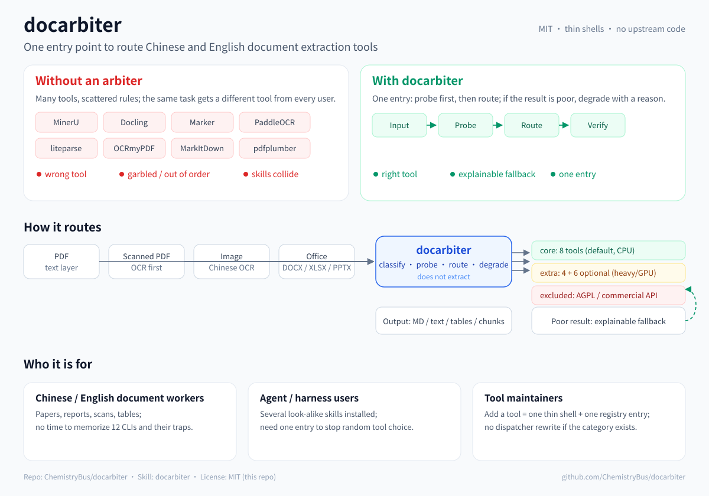

🌐 **English** | [Simplified Chinese](README.zh-CN.md)

<h1 align="center">docarbiter</h1>

<p align="center"><strong>One routing entry for Chinese and English document extraction.</strong></p>
<p align="center">It probes the PDF, picks the right tool, and gives you a fallback when that tool breaks.</p>
<p align="center"><strong>v0.1.3 — Chinese Corpus Routing Fixes</strong></p>

<p align="center">
  <a href="https://github.com/ChemistryBus/docarbiter/actions/workflows/validate.yml"></a>
  <a href="https://github.com/ChemistryBus/docarbiter/releases/tag/v0.1.3"></a>
  <a href="LICENSE"></a>
  
</p>



## The problem

There is no shortage of PDF extractors. The hard part is knowing **which one to use for this file**:

- a text-layer PDF and a scan need different tools;
- Chinese and English fail differently (CID fonts, OCR models, reading order, full-width punctuation);
- a tool that wins on one table can scramble the next one;
- once several look-alike skills are installed, the agent picks one by description and the result stops being reproducible.

`docarbiter` is not another extractor. It is a **thin routing skill** over a tested, curated toolset.

## Quick start

**No CLI? Let your agent install it.** Paste this into Claude Code / Codex / ZCode / MiniMax:

```text
Ask me whether you may install docarbiter on this machine, and wait for my permission. Then run:
curl -fsSL https://raw.githubusercontent.com/ChemistryBus/docarbiter/main/bootstrap.sh | bash
If the current harness already has doc-extract, back it up outside the skills directory before installing docarbiter.
After installation, run ./scripts/doctor.sh --check-conflicts and tell me which tools are missing.
Do not upload or read my documents.
```

The bootstrap only clones this repository and runs `scripts/install.sh`; it does not clone
third-party skill repositories. Read it first if you prefer:
[`bootstrap.sh`](bootstrap.sh).

Manual install:

```bash
git clone https://github.com/ChemistryBus/docarbiter.git
cd docarbiter
./scripts/install.sh --profile core
./scripts/doctor.sh --check-conflicts
```

Route a file without extracting it:

```bash
python3 -I scripts/route.py your-file.pdf --goal manuscript
```

No PDF at hand? Use the bundled scan fixture:

```bash
python3 -I scripts/route.py benchmarks/fixtures/zh-scan.pdf --goal manuscript
# expected: intended=mineru, reason="no usable text layer"
```

## How it routes

| What you have | Default route | Why |
|---|---|---|
| Clean text-layer PDF, speed matters | **liteparse** / **pdftotext** | Fast, local, no OCR |
| Paper / book, needs headings and page anchors | **MinerU** | Structured Markdown + page anchors |
| Scan, CID font, or garbled text layer | **MinerU** | OCR + layout; do not trust the text layer |
| Complex table: merged headers, multi-line cells, book table | **Docling** | Best structure and cell reading order on tested real tables |
| Simple bordered table or coordinates | **pdfplumber** | Fast cells / coordinates; not for complex book tables |
| Office, HTML, EPUB, audio/video, RAG chunks | **Docling** | Broad format coverage |
| Image or screenshot | **RapidOCR** | Lightweight Chinese-first OCR |

```bash
# Simple grid: fast path
python3 -I scripts/route.py file.pdf --goal table --json

# Real book/standard table: structure-preserving path
python3 -I scripts/route.py file.pdf --goal table-structure --json
```

The router reports `probe`, `intended`, `selected`, `reason`, `command`, and `fallback`. It only probes the first pages; for a book or standard, locate the target page first and probe that page.

## Core tools

Eight tools are installed by default. The registry has 18 entries and the repo ships 12 thin tool shells; the default install registers **only** `docarbiter`.

| Tool | Best at |
|---|---|
| **MinerU** | Chinese/English PDF → structured Markdown, page anchors, OCR |
| **Docling** | Office / HTML / EPUB / RAG / LaTeX, and complex merged tables |
| **liteparse** | Fast text-layer PDF, word coordinates |
| **MarkItDown** | Simple single-column PDF / Office |
| **RapidOCR** | Chinese-first image and screenshot OCR |
| **OCRmyPDF** | Add a searchable text layer to scans |
| **pdfplumber** | Simple bordered tables and character coordinates |
| **pdftotext** | Plain-text baseline and text-layer probe |

Full licenses, install commands, and exclusion reasons: [docs/tool-registry.md](docs/tool-registry.md) and [registry.json](registry.json).

## Validation

| Area | Result |
|---|---|
| Core text layer / scans / CID / two-column | Tested; see [docs/benchmarks.md](docs/benchmarks.md) |
| Real high-frequency tables | Structure + spot checks; Docling / MinerU / pdfplumber split by table type |
| P0 routing policy (22 documents with answer keys) | `router:text` 100% success / median CER 0.0000 / 4.73 s; fixed MinerU 100% / 0.0115 / 61.98 s |
| Router commands | Availability and the generated command share one entry point; spaces, quotes, `$`, and CJK paths covered by the self-test |
| Page structure | MinerU page markers checked for full and selected exports; blank page preserved (`scripts/check_pagemarkers.py`) |
| Real-table per-cell CER | WS/T 578.1 p8: pdfplumber default / Docling / MinerU all 0.0000 `nopunct` CER; GB 28050 p6: Docling 0.0000, MinerU 0.1237, pdfplumber 0.3010; GB 2760 p13: pdfplumber default / Docling 0.0000, MinerU 0.1071 (three hand-checked pages) |
| Full-text two-column CER | BERT: Docling 0.0656 / MinerU 0.0773 / liteparse 0.1398 / pdftotext 0.2108; Cell Perspective: pdftotext 0.0349 / MinerU 0.0953 / Docling 0.1099; ResNet: MinerU 0.1214 / Docling 0.1537 / liteparse 0.2287 / pdftotext 0.4212; Nature Communications: Docling 0.1209 / liteparse 0.1259 / MinerU 0.1322 / pdftotext 0.1733; PLOS Comp Biol: Docling 0.1586 / liteparse 0.1950 / pdftotext 0.1976 / MinerU 0.2552 (`nopunct`, five papers; coverage caveat) |
| Harness trigger | Claude Code, DSH, ZCode and MiniMax tested; Codex conditional (large skill catalog) |
| CI | GitHub Actions `validate` green on Ubuntu + macOS; Windows unverified |

Known limits are explicit: true vertical text and symbol-glyph fidelity are not solved. Per-cell CER is measured on three real table pages (WS/T 578.1 p8, GB 28050 p6, GB 2760 p13), and full-text two-column CER on five papers (BERT, Cell Perspective, ResNet, Nature Communications, PLOS Computational Biology). Docling is the most consistent, MinerU is strong on ACL/CVPR but weak on the equation-heavy PLOS paper, and coverage above 1.1 means some figure/SI text is included in the CER; the Nature flagship was excluded because its Methods/Extended Data exceed the main-body scope. These are not general accuracy claims. The README keeps the summary; the evidence lives in [docs/policy.md](docs/policy.md), [docs/benchmarks.md](docs/benchmarks.md), and [docs/gotchas.md](docs/gotchas.md).

## Install options

```bash
# Recommended: core tools + the single docarbiter entry point
./scripts/install.sh --profile core

# Register the skill only (quick trial; install tools separately)
./scripts/install.sh --skills-only --skills-dir ~/.claude/skills

# Extra / full: heavy or GPU tools, not all benchmarked yet
./scripts/install.sh --profile extra
./scripts/install.sh --profile full

# Health check: missing tools, versions, duplicate skills, dual routers
./scripts/doctor.sh --check-conflicts
```

> **Installer scope:** this project does not clone third-party skill repositories. `--profile core` installs pinned Python packages and system dependencies through `pip` / `brew` / `apt`; the upstream tools may download their own model weights on first run. `--skills-only` installs no tools. The 12 tool shells under `skills/_tools/` are original command/positioning notes, not copies of upstream repositories.

Per-tool upstream links, licenses, and copy-paste install commands: **[docs/install-routed-tools.md](docs/install-routed-tools.md)**. Existing `~/.local/bin` wrappers are backed up as `.bak.<timestamp>` before replacement.

Other harnesses use the same command with their skill directory:

```bash
./scripts/install.sh --skills-only --skills-dir ~/.dsh/skills
./scripts/install.sh --skills-only --skills-dir ~/.zcode/skills
./scripts/install.sh --skills-only --skills-dir ~/.codex/skills
./scripts/install.sh --skills-only --skills-dir ~/.agents/skills   # MiniMax / shared agents dir
```

Keep **exactly one** document-extraction router per harness. If `doc-extract` and `docarbiter` coexist, the harness may pick the old one or load both. Migration and rollback: [docs/migration.md](docs/migration.md).

## Documentation

| | |
|---|---|
| Architecture and registry | [docs/architecture.md](docs/architecture.md) · [docs/tool-registry.md](docs/tool-registry.md) |
| Benchmarks and policy | [docs/benchmarks.md](docs/benchmarks.md) · [docs/policy.md](docs/policy.md) |
| Traps and failure modes | [docs/gotchas.md](docs/gotchas.md) |
| Harness integration | [docs/harness-integration.md](docs/harness-integration.md) |
| Updating skills | [docs/updating.md](docs/updating.md) |
| Maintainer handoff | [docs/handoff.md](docs/handoff.md) |
| Release notes | [v0.1.3](https://github.com/ChemistryBus/docarbiter/releases/tag/v0.1.3) · [docs/release-notes-v0.1.3.md](docs/release-notes-v0.1.3.md) |

## License

This repository is **MIT**. It contains original documentation, wrappers, and install scripts only; it does not redistribute upstream code or model weights.

MinerU is Apache-2.0 with additional terms; the additional terms trigger at large commercial scale or when providing an online service based on MinerU. This project calls the CLI locally and does not redistribute it. Full text and the AGPL / proprietary exclusions: [THIRD_PARTY_NOTICES.md](THIRD_PARTY_NOTICES.md) and [docs/licensing-faq.md](docs/licensing-faq.md).
