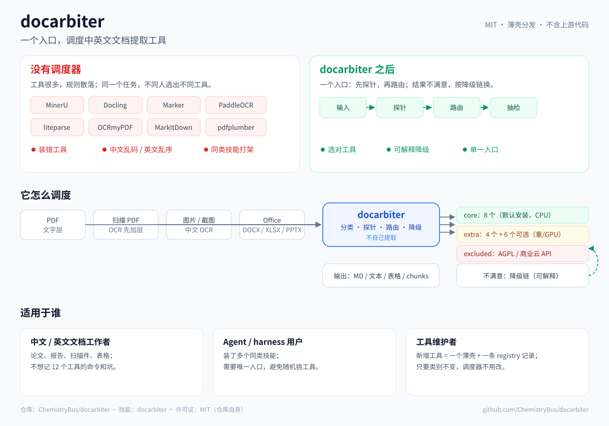

<p align="right"><a href="README.en.md"></a></p>

<h1 align="center">docarbiter</h1>

<p align="center"><strong>中英文文档提取的路由层</strong></p>
<p align="center">先探测文件，再选工具；工具不行时，给出可解释的降级链。</p>
<p align="center"><strong>v0.1.3 — Chinese Corpus Routing Fixes</strong></p>

<p align="center">
  <a href="https://github.com/ChemistryBus/docarbiter/actions/workflows/validate.yml"></a>
  <a href="https://github.com/ChemistryBus/docarbiter/releases/tag/v0.1.3"></a>
  <a href="LICENSE"></a>
  
</p>



## 它是什么

提取工具并不缺，难的是**这个文件该用哪个**。

`docarbiter` 不是又一个 PDF 提取器，也不是模型。它是一个很薄的**路由 skill**：先探测文件，再选择工具，工具失败时给出下一跳。默认覆盖 8 个核心工具，registry 里登记 18 个，仓库只包含自己的文档、封装和安装脚本，不包含上游代码或模型权重。

它主要解决四类问题：

- 有文字层的 PDF 和扫描件，需要完全不同的工具；
- 中文和英文的失败方式不同：CID 字体、OCR 模型、双栏阅读顺序、全角标点、合并单元格；
- 一个工具在这张表上表现好，下一张表可能就乱序；
- 同类技能装多了，agent 按 description 随机选，结果不可复现。

## 30 秒开始

### 方式一：让 agent 帮你装

把下面这段直接发给 Claude Code / Codex / ZCode / MiniMax：

```text
请先问我是否允许在本机安装 docarbiter，得到允许后再执行：
curl -fsSL https://raw.githubusercontent.com/ChemistryBus/docarbiter/main/bootstrap.sh | bash
如果当前 harness 里已有 doc-extract，先把它备份到技能目录之外，再安装 docarbiter。
安装完成后运行 ./scripts/doctor.sh --check-conflicts，并告诉我缺哪些工具。
不要上传或读取我的文档内容。
```

`bootstrap.sh` 只做两件事：克隆这个仓库，运行 `scripts/install.sh`。它不会克隆第三方技能仓库；上游工具第一次运行时会自己下载模型。想先检查脚本再运行，见 [`bootstrap.sh`](bootstrap.sh)。

### 方式二：手动安装

```bash
git clone https://github.com/ChemistryBus/docarbiter.git
cd docarbiter
./scripts/install.sh --profile core
./scripts/doctor.sh --check-conflicts
```

### 先试一次路由

```bash
python3 -I scripts/route.py 你的文件.pdf --goal manuscript
```

没有 PDF？用仓库自带的扫描样本：

```bash
python3 -I scripts/route.py benchmarks/fixtures/zh-scan.pdf --goal manuscript
# 预期：intended=mineru，原因是没有可用文字层
```

路由只给判断，不会替你提取。确认命令后再运行对应工具。

## 怎么路由

<table width="960">
  <colgroup><col width="360"><col width="220"><col width="380"></colgroup>
  <thead>
    <tr>
      <th width="360" align="left">你手上的文件</th>
      <th width="220" align="left">默认路由</th>
      <th width="380" align="left">为什么</th>
    </tr>
  </thead>
  <tbody>
    <tr>
      <td width="360" align="left">文字层干净，只想快速读</td>
      <td width="220" align="left"><strong>liteparse</strong> / <strong>pdftotext</strong></td>
      <td width="380" align="left">快、本地、不跑 OCR</td>
    </tr>
    <tr>
      <td width="360" align="left">论文 / 书，需要标题层级和页码锚点</td>
      <td width="220" align="left"><strong>MinerU</strong></td>
      <td width="380" align="left">结构化 Markdown + 页码</td>
    </tr>
    <tr>
      <td width="360" align="left">扫描件、CID 字体、乱码文字层</td>
      <td width="220" align="left"><strong>MinerU</strong></td>
      <td width="380" align="left">OCR + 版面；不要信文字层</td>
    </tr>
    <tr>
      <td width="360" align="left">复杂表格：合并表头、多行单元格、书刊表</td>
      <td width="220" align="left"><strong>Docling</strong></td>
      <td width="380" align="left">在已测真实表格上结构最稳</td>
    </tr>
    <tr>
      <td width="360" align="left">简单有框表格、字符坐标</td>
      <td width="220" align="left"><strong>pdfplumber</strong></td>
      <td width="380" align="left">快；不适合复杂书刊表</td>
    </tr>
    <tr>
      <td width="360" align="left">Office / HTML / EPUB / 音视频 / RAG 分块</td>
      <td width="220" align="left"><strong>Docling</strong></td>
      <td width="380" align="left">格式覆盖广</td>
    </tr>
    <tr>
      <td width="360" align="left">图片 / 截图</td>
      <td width="220" align="left"><strong>RapidOCR</strong></td>
      <td width="380" align="left">轻量、中文优先</td>
    </tr>
  </tbody>
</table>

```bash
# 简单网格表：先走快路径
python3 -I scripts/route.py 文件.pdf --goal table --json

# 真实书刊表 / 标准表：保留结构
python3 -I scripts/route.py 文件.pdf --goal table-structure --json
```

路由会输出 `probe`、`intended`、`selected`、`reason`、`command` 和 `fallback`。它只抽前几页；长文档先定位目标页，再用 `--page` 探测那一页。

## 适合 / 不适合

**适合：**

- 研究生、科研人员、知识工作者：经常处理论文、标准、报告、扫描件；
- 需要把 PDF 变成 Markdown、纯文本、表格或带页码锚点的段落；
- 文件类型混杂：文字层、扫描件、双栏、表格、中英混排；
- 在 agent 里装了多个提取技能，发现选工具不稳定；
- 愿意本地运行，不想把文档传到云端。

**不适合：**

- 只需要极简纯文本预览：直接 `pdftotext` 就够；
- 需要在线 API / 云端批量服务：这个项目默认本地；
- 要求 100% 免校对：没有工具能做到；
- 手写体、复杂公式、化学结构的完美还原：仍要人工复核；
- 只需要 PDF 合并 / 拆分 / 表单：用 qpdf / pypdf，不要走这个技能。

## 核心工具

默认安装 8 个核心工具；`full` 会注册 12 个工具技能。默认只注册 `docarbiter` 一个入口。

<table width="960">
  <colgroup><col width="230"><col width="730"></colgroup>
  <thead>
    <tr>
      <th width="230" align="left">工具</th>
      <th width="730" align="left">最擅长</th>
    </tr>
  </thead>
  <tbody>
    <tr>
      <td width="230" align="left"><strong>MinerU</strong></td>
      <td width="730" align="left">中英文 PDF → 结构化 Markdown、页码锚点、OCR</td>
    </tr>
    <tr>
      <td width="230" align="left"><strong>Docling</strong></td>
      <td width="730" align="left">Office / HTML / EPUB / RAG / LaTeX，复杂合并表格</td>
    </tr>
    <tr>
      <td width="230" align="left"><strong>liteparse</strong></td>
      <td width="730" align="left">快速读文字层 PDF、词级坐标</td>
    </tr>
    <tr>
      <td width="230" align="left"><strong>MarkItDown</strong></td>
      <td width="730" align="left">简单单栏 PDF / Office</td>
    </tr>
    <tr>
      <td width="230" align="left"><strong>RapidOCR</strong></td>
      <td width="730" align="left">中文优先的图片、截图 OCR</td>
    </tr>
    <tr>
      <td width="230" align="left"><strong>OCRmyPDF</strong></td>
      <td width="730" align="left">给扫描件加可搜索文字层</td>
    </tr>
    <tr>
      <td width="230" align="left"><strong>pdfplumber</strong></td>
      <td width="730" align="left">简单有框表格、字符坐标</td>
    </tr>
    <tr>
      <td width="230" align="left"><strong>pdftotext</strong></td>
      <td width="730" align="left">纯文本基线、文字层探测</td>
    </tr>
  </tbody>
</table>

完整许可证、安装命令和不收录原因：[docs/tool-registry.md](docs/tool-registry.md) 和 [registry.json](registry.json)。

## 证据，不是“准确率”

已经做过的验证：

- **真实表格逐单元格 CER**：WS/T 578.1 p8、GB 28050 p6、GB 2760 p13 三页手工 truth；
- **真实双栏论文全文 CER**：BERT、Cell Perspective、ResNet、Nature Communications、PLOS Computational Biology 五篇，使用 PMC JATS / ar5iv 作为独立 truth；
- **P0 路由策略**：22 份带答案的文档，检查路由成功率、CER 和耗时；
- **复杂中文语料审计**：43 份期刊论文/学位论文 + 20 份标准/法规，覆盖扫描、混合文字层、隐藏 OCR、FzBookMaker 自定义编码和 200–400 页长文档。

这些结果只代表已测样本，不是通用准确率。Docling 在已测表格和多数论文上最稳；MinerU 在扫描、页码锚点和部分论文上更强；pdfplumber 只适合简单表格。完整数字、覆盖率和 caveat 在 [docs/benchmarks.md](docs/benchmarks.md) 和 [docs/policy.md](docs/policy.md)。

## 支持哪些 harness

<table width="960">
  <colgroup><col width="260"><col width="700"></colgroup>
  <thead>
    <tr>
      <th width="260" align="left">Harness</th>
      <th width="700" align="left">状态</th>
    </tr>
  </thead>
  <tbody>
    <tr>
      <td width="260" align="left">Claude Code</td>
      <td width="700" align="left">完整通过（文件软链）</td>
    </tr>
    <tr>
      <td width="260" align="left">DSH</td>
      <td width="700" align="left">完整通过（文件软链）</td>
    </tr>
    <tr>
      <td width="260" align="left">ZCode</td>
      <td width="700" align="left">完整通过（文件软链）</td>
    </tr>
    <tr>
      <td width="260" align="left">MiniMax</td>
      <td width="700" align="left">完整通过（<code>.agents/skills</code> 整目录软链）</td>
    </tr>
    <tr>
      <td width="260" align="left">Codex</td>
      <td width="700" align="left">条件通过：技能目录很大时，可能需要显式说“用 docarbiter”</td>
    </tr>
  </tbody>
</table>

每个 harness **只保留一个**文档提取路由器。如果 `doc-extract` 和 `docarbiter` 同时存在，agent 可能选旧的那个。迁移和回滚见 [docs/migration.md](docs/migration.md)。

## 安装选项

```bash
# 推荐：核心工具 + 唯一 docarbiter 入口
./scripts/install.sh --profile core

# 只注册技能（先试用；工具另行安装）
./scripts/install.sh --skills-only --skills-dir ~/.claude/skills

# extra / full：重型或 GPU 工具，未全部基准测试
./scripts/install.sh --profile extra
./scripts/install.sh --profile full

# 体检：缺工具、版本漂移、重名技能、双路由器
./scripts/doctor.sh --check-conflicts
```

> 安装器不会克隆第三方技能仓库。`--profile core` 通过 `pip` / `brew` / `apt` 安装固定版本的 Python 包和系统依赖；上游工具可能自行下载模型。`--skills-only` 不安装任何工具。`skills/_tools/` 下的 12 个工具壳是本仓库原创的命令/定位说明，不是上游仓库的副本。

其他 harness 用同一个命令，换技能目录：

```bash
./scripts/install.sh --skills-only --skills-dir ~/.dsh/skills
./scripts/install.sh --skills-only --skills-dir ~/.zcode/skills
./scripts/install.sh --skills-only --skills-dir ~/.codex/skills
./scripts/install.sh --skills-only --skills-dir ~/.agents/skills   # MiniMax / 共享 agents 目录
```

## 常见问题

**会上传我的文档吗？**

默认不会。工具在本地运行；只有你主动使用的云服务或上游工具自己的联网行为除外。仓库不包含遥测。

**扫描件能处理吗？**

能，但不是“一键完美”。MinerU 直接 OCR；OCRmyPDF 可以先加文字层；RapidOCR 适合单张图片。扫描质量、倾斜、印章和手写都会影响结果，发布前要抽查。

**为什么不能保证 100% 准确？**

因为没有工具能。路由只负责选对路径和给出降级链；最终文本仍要按用途校对，尤其是表格、公式和专有名词。

**Windows 能用吗？**

核心命令是 Python + shell 封装，macOS 已测，Linux 由 CI 覆盖；Windows 还没有系统验证。WSL 可以试，但请把问题贴到 issue。

**和旧的 doc-extract 冲突怎么办？**

先备份旧目录到技能目录之外，再安装 docarbiter；然后运行 `./scripts/doctor.sh --check-conflicts`。不要同时保留两个路由器。

**表格到底用哪个？**

简单有框表先 `--goal table`（pdfplumber）；合并表头、多行单元格、书刊/标准表用 `--goal table-structure`（Docling）；扫描表格用 MinerU。

## 文档

<table width="960">
  <colgroup><col width="280"><col width="680"></colgroup>
  <tbody>
    <tr>
      <td width="280" align="left">架构与工具注册表</td>
      <td width="680" align="left"><a href="docs/architecture.md">docs/architecture.md</a> · <a href="docs/tool-registry.md">docs/tool-registry.md</a></td>
    </tr>
    <tr>
      <td width="280" align="left">基准与策略</td>
      <td width="680" align="left"><a href="docs/benchmarks.md">docs/benchmarks.md</a> · <a href="docs/policy.md">docs/policy.md</a></td>
    </tr>
    <tr>
      <td width="280" align="left">失败模式与坑</td>
      <td width="680" align="left"><a href="docs/gotchas.md">docs/gotchas.md</a></td>
    </tr>
    <tr>
      <td width="280" align="left">Harness 接入</td>
      <td width="680" align="left"><a href="docs/harness-integration.md">docs/harness-integration.md</a></td>
    </tr>
    <tr>
      <td width="280" align="left">更新技能</td>
      <td width="680" align="left"><a href="docs/updating.md">docs/updating.md</a></td>
    </tr>
    <tr>
      <td width="280" align="left">迁移与回滚</td>
      <td width="680" align="left"><a href="docs/migration.md">docs/migration.md</a></td>
    </tr>
    <tr>
      <td width="280" align="left">维护交接</td>
      <td width="680" align="left"><a href="docs/handoff.md">docs/handoff.md</a></td>
    </tr>
    <tr>
      <td width="280" align="left">发布说明</td>
      <td width="680" align="left"><a href="https://github.com/ChemistryBus/docarbiter/releases/tag/v0.1.3">v0.1.3</a> · <a href="docs/release-notes-v0.1.3.md">docs/release-notes-v0.1.3.md</a></td>
    </tr>
  </tbody>
</table>

## 许可

本仓库是 **MIT**。它只包含原创文档、封装和安装脚本，不再分发上游代码或模型权重。

MinerU 是 Apache-2.0 + 附加条款；大规模商业使用或基于 MinerU 提供在线服务时，附加条款会触发。本项目只在本地调用 CLI，不再分发 MinerU。完整条款和 AGPL / 专有工具的排除原因见 [THIRD_PARTY_NOTICES.md](THIRD_PARTY_NOTICES.md) 和 [docs/licensing-faq.md](docs/licensing-faq.md)。
