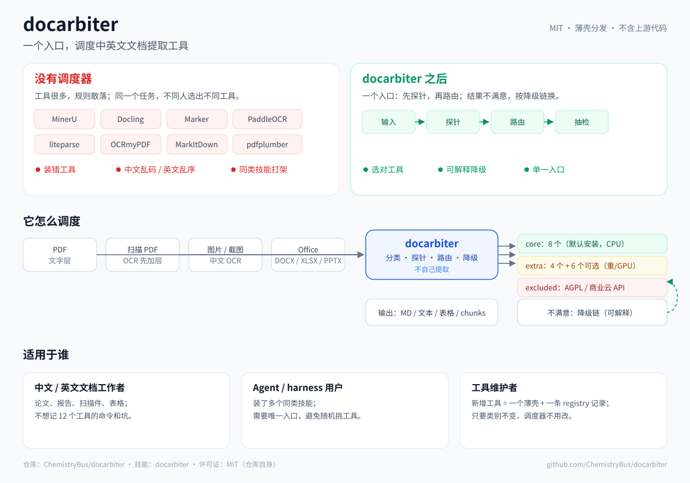

🌐 [English](README.md) | **简体中文**

<h1 align="center">docarbiter</h1>

<p align="center"><strong>中英文文档提取的唯一路由入口。</strong></p>
<p align="center">先探测 PDF，再选工具；工具不行时，给出可解释的降级链。</p>
<p align="center"><strong>v0.1.1 — Harness Compatibility Patch</strong></p>

<p align="center">
  <a href="https://github.com/ChemistryBus/docarbiter/actions/workflows/validate.yml"></a>
  <a href="https://github.com/ChemistryBus/docarbiter/releases/tag/v0.1.1"></a>
  <a href="LICENSE"></a>
  
</p>



## 它解决什么问题

提取工具并不缺，难的是**这个文件该用哪个**：

- 有文字层的 PDF 和扫描件，需要不同工具；
- 中文和英文的失败方式不同：CID 字体、中文 OCR 模型、阅读顺序、全角标点、合并单元格；
- 一个工具在这张表上赢，下一张表可能就乱序；
- 同类技能装多了，agent 按 description 随机选，结果不可复现。

`docarbiter` 不是又一个提取器，而是覆盖一套经过测试的工具集的**薄路由层**。

## 快速开始

**不想用命令行？直接把下面这段交给 agent。** 粘贴到 Claude Code / Codex / ZCode / MiniMax：

```text
请先问我是否允许在本机安装 docarbiter。得到允许后执行：
curl -fsSL https://raw.githubusercontent.com/ChemistryBus/docarbiter/main/bootstrap.sh | bash
如果当前 harness 里已有 doc-extract，先把它备份到技能目录之外，再安装 docarbiter。
安装完成后运行 ./scripts/doctor.sh --check-conflicts，并告诉我缺哪些工具。
不要上传或读取我的文档内容。
```

`bootstrap.sh` 只克隆本仓库并调用 `scripts/install.sh`，不会克隆第三方的技能仓库。想先检查可读 [`bootstrap.sh`](bootstrap.sh)。

手动安装：

```bash
git clone https://github.com/ChemistryBus/docarbiter.git
cd docarbiter
./scripts/install.sh --profile core
./scripts/doctor.sh --check-conflicts
```

只路由、不提取：

```bash
python3 -I scripts/route.py 你的文件.pdf --goal manuscript
```

手边没有 PDF？用仓库里的扫描件样本：

```bash
python3 -I scripts/route.py benchmarks/fixtures/zh-scan.pdf --goal manuscript
# 预期：intended=mineru，reason="no usable text layer"
```

## 路由规则

| 你的输入 | 默认路线 | 原因 |
|---|---|---|
| 干净文字层，追求速度 | **liteparse** / **pdftotext** | 快、本地、不用 OCR |
| 论文 / 书，要标题层级和页码锚点 | **MinerU** | 结构化 Markdown + 页码锚点 |
| 扫描件、CID 字体、文字层乱码 | **MinerU** | OCR + 版面还原；不要信坏文字层 |
| 复杂表：合并表头、多行单元格、书表 | **Docling** | 在真实表上结构和单元格阅读顺序最好 |
| 简单有框线表格 / 坐标 | **pdfplumber** | 快；不适合复杂书表 |
| Office / HTML / EPUB / 音视频 / RAG | **Docling** | 格式覆盖最广 |
| 图片 / 截图 | **RapidOCR** | 轻量、中文优先 |

```bash
# 简单网格：快路径
python3 -I scripts/route.py file.pdf --goal table --json

# 真实书表 / 标准表：保结构
python3 -I scripts/route.py file.pdf --goal table-structure --json
```

路由输出包含 `probe`、`intended`、`selected`、`reason`、`command`、`fallback`。它只探测前几页；书/标准要先定位目标页，再单独探测。

## 核心工具

默认安装 8 个工具。registry 共 18 个条目，仓库有 12 个工具薄壳；默认只注册 **`docarbiter` 一个技能**。

| 工具 | 最擅长 |
|---|---|
| **MinerU** | 中英文 PDF → 结构化 Markdown、页码锚点、OCR |
| **Docling** | Office / HTML / EPUB / RAG / LaTeX，以及复杂合并表 |
| **liteparse** | 快速读文字层 PDF、词级坐标 |
| **MarkItDown** | 简单单栏 PDF / Office |
| **RapidOCR** | 中文优先的图片 / 截图 OCR |
| **OCRmyPDF** | 给扫描件补可搜索文字层 |
| **pdfplumber** | 简单有框线表格、字符坐标 |
| **pdftotext** | 纯文字基线和文字层探针 |

完整许可、安装命令和排除原因：[docs/tool-registry.md](docs/tool-registry.md)、[registry.json](registry.json)。

## 验证状态

| 范围 | 结果 |
|---|---|
| core 文字层 / 扫描 / CID / 双栏 | 已测；见 [docs/benchmarks.md](docs/benchmarks.md) |
| 真实高频表 | 结构 + 抽检；Docling / MinerU / pdfplumber 按表型分流 |
| P0 路由策略（22 个有答案文档） | `router:text` 成功率 100% / 中位 CER 0.0000 / 4.73s；固定 MinerU 100% / 0.0115 / 61.98s |
| 路由命令 | 可用性检查与生成的命令使用同一入口；空格、引号、`$`、中文路径均由自测覆盖 |
| 页码结构 | 全页与选页导出的 MinerU 页码标记已回归；空白页保留（`scripts/check_pagemarkers.py`） |
| 真实表逐单元格 CER | WS/T 578.1 p8：pdfplumber 默认 / Docling / MinerU 均 0.0000（nopunct）；GB 28050 p6：Docling 0.0000、MinerU 0.1237、pdfplumber 0.3010（两页人工 truth） |
| 双栏全文 CER | BERT 全文：Docling 0.0656 / MinerU 0.0773 / liteparse 0.1398 / pdftotext 0.2108（nopunct）；Cell Perspective：pdftotext 0.0349 / MinerU 0.0953 / Docling 0.1099（两篇论文；Cell 含图内文字，需看 caveat） |
| Harness 触发 | Claude Code、DSH、ZCode、MiniMax 已测；Codex 条件通过（大技能目录） |
| CI | GitHub Actions `validate` 通过；Ubuntu + macOS 由 CI 覆盖，Windows 未验证 |

已知边界写清楚：真竖排、符号字形保真还没解决；真实表逐单元格 CER 已在两页上实测（WS/T 578.1 p8、GB 28050 p6），双栏全文 CER 已在两篇论文上实测（BERT 全文、Cell Perspective；Cell 图内有文字，排名需看 caveat），都不能外推成通用准确率。README 只放摘要，完整证据在 [docs/policy.md](docs/policy.md)、[docs/benchmarks.md](docs/benchmarks.md) 和 [docs/gotchas.md](docs/gotchas.md)。

## 安装选项

```bash
# 推荐：core 工具 + 唯一入口 docarbiter
./scripts/install.sh --profile core

# 只注册技能快速试用；工具另装
./scripts/install.sh --skills-only --skills-dir ~/.claude/skills

# extra / full：重型或 GPU 工具，尚未逐项实测
./scripts/install.sh --profile extra
./scripts/install.sh --profile full

# 体检：缺工具、版本、重名技能、双路由
./scripts/doctor.sh --check-conflicts
```

> **安装器边界：** 本项目不会克隆别人的技能仓库。`--profile core` 只通过 `pip` / `brew` / `apt` 安装锁定版本的 Python 包和系统依赖；上游工具首次运行时可能自行下载模型权重。`--skills-only` 不装任何工具。`skills/_tools/` 下的 12 个薄壳是自撰的命令/定位说明，不是上游仓库的副本。

逐个工具的上游链接、许可证和可直接复制的安装命令：**[docs/install-routed-tools.md](docs/install-routed-tools.md)**。`~/.local/bin` 里已有的同名 wrapper 会先备份为 `.bak.<timestamp>` 再替换。

其他 harness 用同一个命令指定技能目录：

```bash
./scripts/install.sh --skills-only --skills-dir ~/.dsh/skills
./scripts/install.sh --skills-only --skills-dir ~/.zcode/skills
./scripts/install.sh --skills-only --skills-dir ~/.codex/skills
./scripts/install.sh --skills-only --skills-dir ~/.agents/skills   # MiniMax / 共享 agents 目录
```

**一个 harness 只保留一个文档提取路由器。** 如果 `doc-extract` 和 `docarbiter` 共存，可能选旧路由，也可能两个都加载。迁移和回滚：[docs/migration.md](docs/migration.md)。

## 文档

| | |
|---|---|
| 架构与注册表 | [docs/architecture.md](docs/architecture.md) · [docs/tool-registry.md](docs/tool-registry.md) |
| 评测与策略 | [docs/benchmarks.md](docs/benchmarks.md) · [docs/policy.md](docs/policy.md) |
| 实测坑与失败模式 | [docs/gotchas.md](docs/gotchas.md) |
| Harness 接入 | [docs/harness-integration.md](docs/harness-integration.md) |
| 更新技能 | [docs/updating.md](docs/updating.md) |
| 维护交接 | [docs/handoff.md](docs/handoff.md) |
| Release notes | [v0.1.1](https://github.com/ChemistryBus/docarbiter/releases/tag/v0.1.1) · [docs/release-notes-v0.1.1.md](docs/release-notes-v0.1.1.md) |

## 许可

本仓库为 **MIT**，只含自撰文档、wrapper 和安装脚本，不重新分发上游代码或模型权重。

MinerU 是 Apache-2.0 + 附加条款；附加条款只在大规模商业使用或基于 MinerU 提供在线服务时触发。本项目只在本机调用 CLI，不重新分发 MinerU。完整条款、AGPL / Proprietary 排除说明见 [THIRD_PARTY_NOTICES.md](THIRD_PARTY_NOTICES.md) 和 [docs/licensing-faq.md](docs/licensing-faq.md)。
